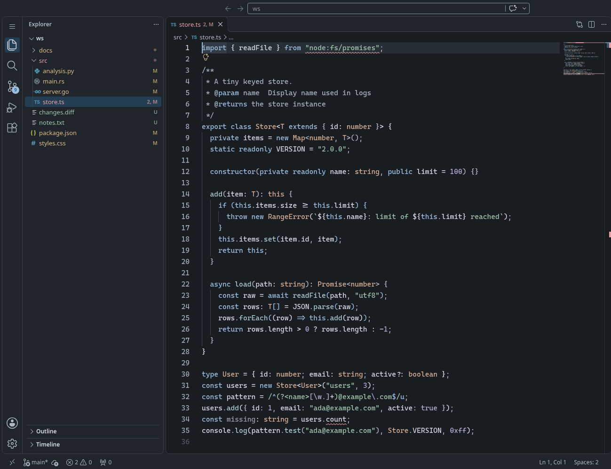
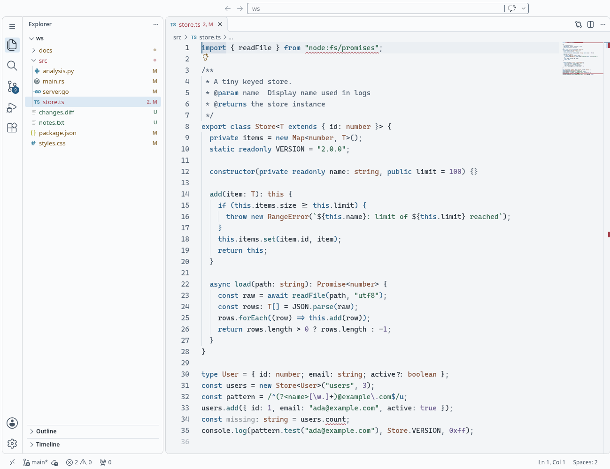

# Flatcap for Visual Studio Code

   [](https://marketplace.visualstudio.com/items?itemName=cheycron.flatcap-theme)

<p align="center">
  
</p>

<p align="center">
  
</p>

<p align="center"><sub>Flatcap Slate (dark) above, Flatcap Daylight (light) below.</sub></p>

**Flatcap for Visual Studio Code** brings the Flatcap visual system to the editor: matte graphite surfaces, one mineral-blue accent, and syntax colors that stay in the background until they are needed.

It ships two themes, tuned separately: **Flatcap Slate** (dark) and **Flatcap Daylight** (light).

> The interface organizes. Content takes the foreground. Color informs.

## Install

1. Open the Extensions view (`Ctrl+Shift+X`), search for `Flatcap` and install, or get it from the [Marketplace](https://marketplace.visualstudio.com/items?itemName=cheycron.flatcap-theme).
2. Run **Preferences: Color Theme** and pick **Flatcap Slate** or **Flatcap Daylight**.

## Use it

The themes do not change your settings. To follow the operating system's light/dark mode and use the Flatcap type scale, add this to `settings.json`:

<!-- build:settings -->
```json
{
  "workbench.preferredDarkColorTheme": "Flatcap Slate",
  "workbench.preferredLightColorTheme": "Flatcap Daylight",
  "window.autoDetectColorScheme": true,
  "editor.fontFamily": "'Cascadia Code', 'Cascadia Code NF', 'CaskaydiaCove Nerd Font Mono', Consolas, monospace",
  "editor.fontSize": 15,
  "editor.lineHeight": 24,
  "editor.fontLigatures": true,
  "terminal.integrated.fontFamily": "'Cascadia Code', 'Cascadia Code NF', 'CaskaydiaCove Nerd Font Mono', Consolas, monospace",
  "markdown.preview.fontFamily": "'IBM Plex Sans', 'Segoe UI', sans-serif",
  "markdown.preview.fontSize": 16,
  "markdown.preview.lineHeight": 1.625
}
```
<!-- /build:settings -->

## Fonts

Fonts are not bundled; install them on the machine where VS Code runs. Without them VS Code falls back to the next family in the list, and colors are unaffected. See the [Flatcap typography guide](https://github.com/cheycron/flatcap-theme/blob/main/docs/typography.md).

<!-- build:fonts -->
| Use | Family (exact) |
| :--- | :--- |
| Editor and terminal (default) | `Cascadia Code` |
| Terminal or prompt with icons | `Cascadia Code NF` |
| No ligatures (logs, hashes, literal output) | `Cascadia Mono` |
| No ligatures, with icons | `Cascadia Mono NF` |
| Markdown preview | `IBM Plex Sans` |

Starting size: 15 px with a 24 px line (`font.size.code`, `font.line.code`).
<!-- /build:fonts -->

## Accessibility

Contrast is computed from the theme values against the contracts of the [Flatcap core](https://github.com/cheycron/flatcap-theme), and `python3 scripts/build.py --check` fails if any pair misses its target: 7:1 for editor and sidebar text, 5:1 for secondary text, syntax, links and diagnostics, 3:1 for controls and focus.

Limits that affect you:

- **Selected text** is drawn in one color (`selection.fg`, 5.64:1 in Slate and 9.45:1 in Daylight), in the editor and in the terminal, so syntax and ANSI colors do not apply over a selection.
- **`terminal.ansiBrightWhite` in Daylight** is the raised white surface on purpose (it is for text on colored blocks), so as text on the terminal background it is 1.1:1. In Slate, `terminal.ansiBlack` is a surface tone (1.8:1), not text ink.
- **Decorative surfaces** (hairline borders, selected-row fills) separate by tone only and are not held to 3:1.
- **Computed, not sampled.** Colors that other extensions set for their own views are outside the theme's control.

The contrast table, terminal ANSI mapping and every role-to-key mapping are in the [full mapping](https://github.com/cheycron/flatcap-vscode/blob/main/docs/mapping.md).

## Compatibility

- **VS Code ^1.85** (`engines.vscode`). Versions between 1.85 and 1.145 were not tested one by one.
- Tested on VS Code **1.145** (desktop and web).
- Semantic highlighting is enabled by the themes. Language extensions that provide semantic tokens use the semantic colors; the rest use the TextMate scopes.

## Upgrading from v1

The v1 theme ID `Flatcap` is kept as **Flatcap (v1 name, now Slate)**, so an existing `"workbench.colorTheme": "Flatcap"` keeps working and now renders Slate. The v1 palette (Nord-derived) is gone. Switch to the new names when convenient.

## Contributing

The themes, the `package.json` theme entries and the generated blocks are produced from `src/theme.json`; do not edit them by hand. Run `python3 scripts/build.py --check` before opening a pull request. Mapping details are in [docs/mapping.md](https://github.com/cheycron/flatcap-vscode/blob/main/docs/mapping.md).

## License

MIT © Cheycron Blaine. See [LICENSE](https://github.com/cheycron/flatcap-vscode/blob/main/LICENSE). The cap drawing in the extension icon derives from third-party artwork (Vexels, [terms](https://vexels.com/terms-and-conditions/)) and is not relicensed by MIT.

## Support

If Flatcap makes your workspace calmer, you can support its development.

<p align="center">
  <a href="https://www.buymeacoffee.com/cheycron">
    
  </a>
</p>
